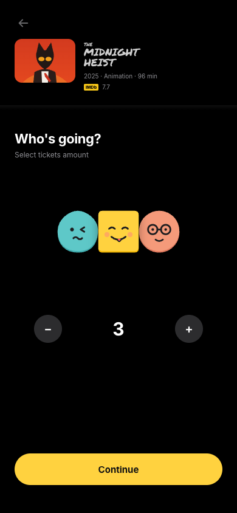
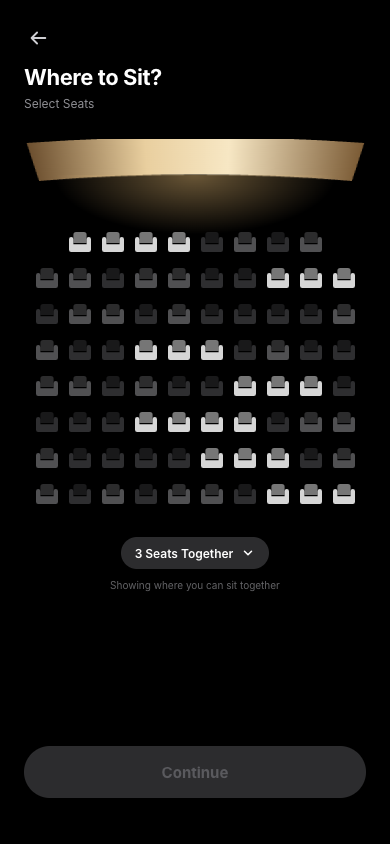
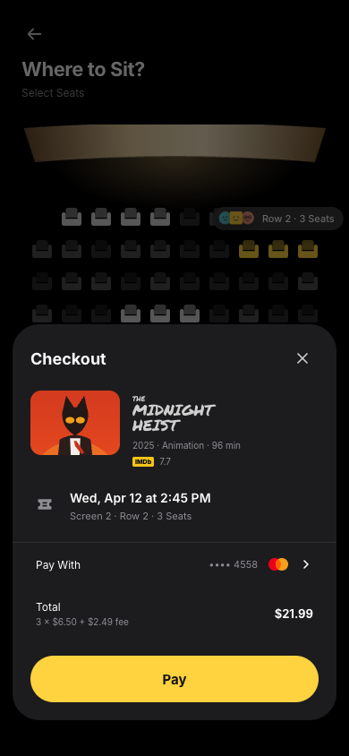
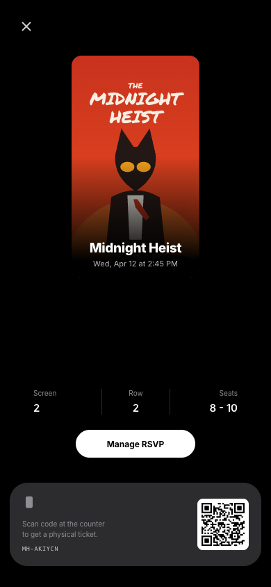

# Cinema Ticket

映画チケット予約アプリのUIを React + TypeScript（Vite）で実装したものです。

**公開中のサイト → https://cinema-ticket-tau.vercel.app** （スマートフォンでの表示を想定しています）

<p>
  
  
  
  
</p>

## 使った技術

React 19、TypeScript、Vite、qrcode.react（チケットの QR コード）。アニメーションと 3D の回転は CSS で書いています。公開は Vercel。

## 画面の流れ

1. **人数を選ぶ** — ＋／−で1〜6人。人数ぶんキャラクターが並ぶ
2. **席を選ぶ** — 並んで座れる席だけが明るく表示され、タップで人数分まとめて選べる（ばらばらに選ぶモードもあり）
3. **支払い** — 合計金額を計算して表示（決済は仮の処理）
4. **チケット生成** — 枠 → 印刷 → 3Dでゆらっと回る演出
5. **チケット** — タップで裏返し、ドラッグで3D回転。QRコード付き

## 開発

```bash
npm install
npm run dev
```

## デプロイ

```bash
npx vercel deploy --prod
```

## ファイル構成

- `src/data.ts` — 映画情報・料金・座席配置と座席のロジック（実データに差し替えるときはここ）
- `src/App.tsx` — 画面遷移と状態管理
- `src/screens/` — 各画面
- `src/index.css` — 見た目とアニメーション
